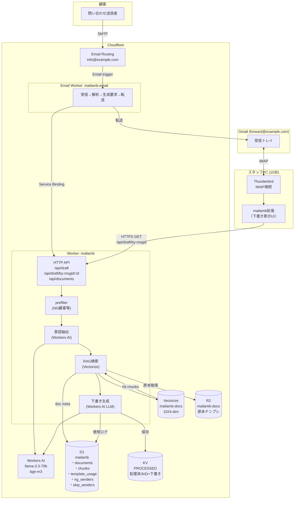

# 02. アーキテクチャ

## 全体構成



## コンポーネント一覧

### Cloudflare 側

| 名前 | 種類 | 役割 |
|---|---|---|
| `mailamb` | Worker | HTTP API本体。RAG+生成オーケストレーション、ドキュメント管理 |
| `mailamb-email` | Email Worker | Email Routing から呼ばれる。受信本文解析→mailamb呼び出し→転送 |
| `mailamb-docs` | Vectorize index | テンプレ・過去対応のベクトル検索（1024次元、cosine） |
| `mailamb` | D1 database | documents / chunks / template_usage / ng_senders / skip_senders |
| `mailamb-docs` | R2 bucket | テンプレ原本（Markdown）、過去対応JSON、生成ログ |
| `PROCESSED` | KV namespace | 処理済み message_id (重複防止) + 下書き全文 (90日TTL) |
| `AI` | Workers AI binding | llama-3.3-70b + bge-m3 |

### Email Routing 設定

| アドレス | ルート | 用途 |
|---|---|---|
| `info@example.com` | → mailamb-email Worker | 問い合わせ受付（本番） |
| `test@example.com` | → forward@example.com | 開発テスト用 |
| `a@example.com` | → forward@example.com | スタッフA（PoC） |
| `b@example.com` | → forward@example.com | スタッフB（PoC） |

### クライアント側

| 名前 | 種類 | 役割 |
|---|---|---|
| Thunderbird 158+ | メールクライアント | 各スタッフのPC、IMAP で Gmail を見る |
| `mailamb@mailamb.local` | TB WebExtension | 下書きパネル表示、Fromセレクタ、返信composeオープン |

## データモデル (D1)

```sql
documents (
  doc_id      TEXT PK,
  type        TEXT,           -- template | manual | past_case
  title       TEXT,
  r2_key      TEXT,           -- R2上のパス
  category    TEXT,
  tags        TEXT,           -- JSON配列
  updated_at  INTEGER,
  active      INTEGER
)

chunks (
  chunk_id    TEXT PK,
  doc_id      TEXT FK,
  r2_key      TEXT,
  offset      INTEGER,
  length      INTEGER,
  preview     TEXT
)

template_usage (
  usage_id        INTEGER PK AUTOINCREMENT,
  doc_id          TEXT FK,
  email_msg_id    TEXT,
  generated_at    INTEGER,
  staff_edited    INTEGER,    -- 下書きが編集されたか (将来)
  staff_discarded INTEGER,
  edit_distance   INTEGER
)

ng_senders (
  email       TEXT PK,
  reason      TEXT,
  added_at    INTEGER
)

skip_senders (
  pattern     TEXT PK,         -- email or domain
  kind        TEXT,            -- mailing_list|auto_reply|sales
  added_at    INTEGER
)
```

## Vectorize index

```
name:    mailamb-docs
dim:     1024
metric:  cosine
metadata indexes:
  - type (string): 'template' | 'past_case' | 'manual'
  - doc_id (string): 元ドキュメントID
```

各ベクトル:
- id: `<doc_id>:<chunk_index>` (例: `tpl-005:0`)
- values: 1024次元ベクトル (bge-m3 出力)
- metadata: `{ doc_id, chunk_id, type, category, updated_at }`

## R2 バケット構成

```
mailamb-docs/
├── templates/<doc_id>.md       # 定型文（Markdown）
├── manuals/<doc_id>.md         # 社内マニュアル（将来）
├── past_cases/<doc_id>.md      # 過去対応ログ（Markdown化済）
└── logs/<yyyy-mm-dd>/<msg>.json # 生成ログ（マスク済、90日保持）
```

## KV キー設計

| キー | 値 | TTL |
|---|---|---|
| `<message_id>` | `"generated"` or `"skip:<reason>"` | 90日 |
| `draft:<message_id>` | DraftResponse の JSON 全文 | 90日 |

TB拡張は `GET /api/draft/by-msgid/<message_id>` で `draft:<message_id>` を取得。

## 認証

- **mailamb Worker**: `X-API-Key` ヘッダ必須（`wrangler secret put API_KEY`）
- **mailamb-email Worker**: Service Binding で mailamb を呼ぶ時に `MAILAMB_API_KEY` secret を使用
- **TB拡張**: `background.js` にAPI Keyハードコード（将来は options UIで動的設定）
- **Cloudflare dashboard**: cfauth 経由の CF OAuth

## 本番URL

```
Main:  https://mailamb.<your-subdomain>.workers.dev
Email: mailamb-email (Email Workerトリガーなのでhttps URLはhealthのみ)
```
