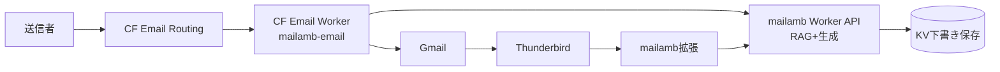
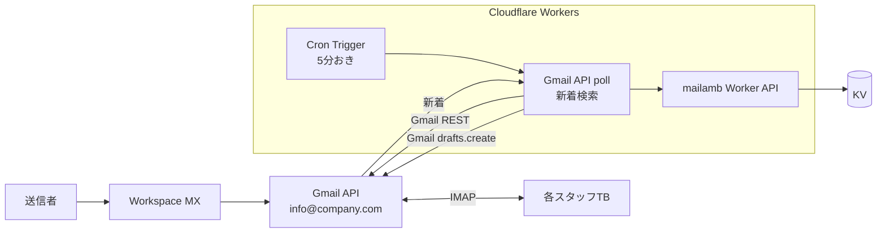

# 08. メール環境別の構成パターン

本番のメール環境は顧客ごとに違う。各ケースに合わせた構成を示す。

## パターン A: Cloudflare Email Routing + Gmail (現状のPoC)

**特徴**: CFがメール受信、転送先はGmail。実際のメールボックスはGmail。



### 向く顧客
- 既にCFドメイン持ち or 移管OK
- Gmail/Workspaceを使ってる
- 送受信者数10名以下

### 制約
- `message.forward()` は **verified destinations** にしか送れない → 全スタッフのメアドをCFに登録・承認必要
- 送信名義を `info@` にするには Gmail Send As 設定（SMTP relay）が必要

---

## パターン B: レンタルサーバ IMAP (さくら、Xserver、Lolipop等)

**特徴**: 実際のメールボックスがレンタルサーバ上にある。CFは使わない。

```mermaid
flowchart LR
    S[送信者] --> MX[レンタルサーバMX<br/>mail.example.com]
    MX --> MB[IMAPメールボックス<br/>info@example.com]
    
    subgraph BOX["母艦PC (Windows常時稼働 or Cronサーバ)"]
        TASK[タスクスケジューラ<br/>5分おき]
        BATCH[Node母艦スクリプト<br/>mother.ts]
    end
    
    TASK --> BATCH
    BATCH -->|IMAP IDLE/poll| MB
    MB -->|新着メール| BATCH
    BATCH -->|HTTPS| API[mailamb Worker API<br/>RAG+生成]
    API --> KV[(KV)]
    BATCH -->|IMAP APPEND| DR[Drafts folder<br/>info@example.com]
    DR -->|IMAP同期| TB[各スタッフTB]
    TB --> EXT[mailamb拡張]
```

### セットアップ

1. **母艦PCを決める**（24h稼働するWin or Macが1台必要）
2. 母艦スクリプトを設置:
   ```
   poc/scripts/05-mother.ts
   ```
   既にPoCに実装済み。
3. `.env` に IMAP接続情報:
   ```
   IMAP_HOST=mail.example.com
   IMAP_PORT=993
   IMAP_USER=info@example.com
   IMAP_PASSWORD=（レンタルサーバのメールアカウントパスワード）
   INQUIRY_ADDRS=info@example.com
   ```
4. タスクスケジューラ or launchd/cron で5分おきに実行:
   ```bash
   # Windows: タスクスケジューラ (General > Run with highest privileges)
   #   Action: `C:\path\to\node.exe C:\path\to\poc\scripts\05-mother.ts`
   # macOS: launchd
   #   /Library/LaunchDaemons/com.mailamb.plist に StartInterval=300
   # Linux: cron
   #   */5 * * * * cd /path/to/poc && pnpm mother
   ```

### 向く顧客
- 既存のレンタルサーバを使い続けたい
- CFに移管できない事情（SPF/DKIM/他サービス連携）
- 全スタッフが同じIMAPメールボックスを共有している（info@を全員が見てる）

### メリット
- 全スタッフが同じDraftsフォルダを見るので「下書き共有」が自然
- CFへの転送設定不要（既存メール運用そのまま）
- Send Asも不要（IMAPのSMTPでそのまま info@名義送信）

### デメリット
- 母艦PCがSPOF（停止すると下書き生成も止まる）
- IMAPパスワードがローカル保管（セキュリティに注意）
- リアルタイム性低（5分遅延）

### IMAP IDLE で即時反応

poc/scripts/05-mother.ts を改修して IMAP IDLE 使うとポーリング不要になる:
```typescript
await client.mailboxOpen("INBOX");
await client.idle();  // 新着まで待機
// 新着検知
```

これなら母艦スクリプトを常時稼働させる（launchd/サービス化）だけで数秒以内に処理。

---

## パターン C: Google Workspace / Microsoft 365

**特徴**: Google/Microsoft のメールボックス、OAuth2 対応。



### セットアップ

1. Google Cloud Console で OAuth2 設定
   - Scope: `https://www.googleapis.com/auth/gmail.modify`
   - refresh_token を取得（スクリプト1回実行）
2. refresh_token を CF Workers Secretに登録:
   ```bash
   cfauth wrangler secret put GMAIL_REFRESH_TOKEN
   cfauth wrangler secret put GMAIL_CLIENT_ID
   cfauth wrangler secret put GMAIL_CLIENT_SECRET
   ```
3. Cron Trigger を wrangler.toml に追加:
   ```toml
   [triggers]
   crons = ["*/5 * * * *"]
   ```
4. Worker 内で Gmail API を叩く:
   ```typescript
   // 新着取得
   const unread = await gmailAPI.users.messages.list({
     userId: 'me',
     q: 'is:unread to:info@company.com newer_than:1d'
   });
   // 下書き作成
   await gmailAPI.users.drafts.create({
     userId: 'me',
     requestBody: { message: { raw: base64Mime } }
   });
   ```

### 向く顧客
- 10名以上の中規模組織
- Google Workspace / M365 契約済み
- 母艦PCを置きたくない

### メリット
- 母艦PC不要（Cloudflare Cron で全部完結）
- OAuth2 なので認証が安全（パスワード平文保存なし）
- Gmail API で確実に Drafts folder に書き込める
- 複数ユーザのメールボックスを別々に処理可能

### デメリット
- OAuth2 設定が初回複雑（refresh_token の取得・更新）
- 5分ポーリング（Gmail Push Notification 使うと即時だがPub/Sub必要）

---

## パターン D: 自前メールサーバ (Postfix/Dovecot)

**特徴**: 社内にメールサーバがある場合（レア）

パターンBと同じ構成だが、IMAP直叩き or MDA（.forwardやprocmail）でWorkerをwebhook発火。

procmail例:
```
:0 c
| curl -X POST https://mailamb.workers.dev/api/draft \
    -H "X-API-Key: $KEY" \
    -H "Content-Type: application/json" \
    -d @-
```

受信即Workerに流せるので遅延ゼロ。

---

## どのパターンを選ぶか

| 条件 | 推奨 |
|---|---|
| 既にCFドメイン + Gmail/Workspace | **A** (今のPoC) |
| さくら/Xserver等のレンタルサーバを継続 | **B** (母艦PC + IMAP) |
| Google Workspace/M365 契約済 | **C** (Gmail API + Cron) |
| 自前メールサーバ | **D** (procmail/MDA) |
| とにかく手軽 | **A** （無料枠内） |
| 本番SLA重視 | **C** （母艦SPOFなし） |

パターンBだけ母艦PCが必要なので、継続運用コスト（PC電気代・故障対応）を見込んでおく。他は全てクラウド側で完結。
