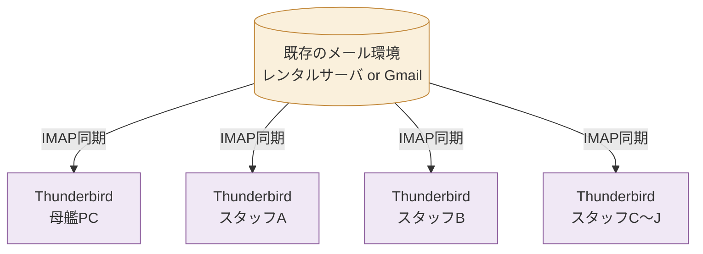
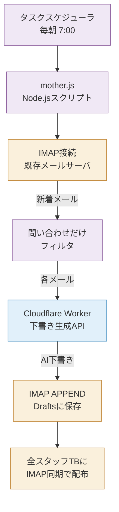
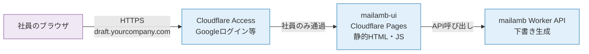
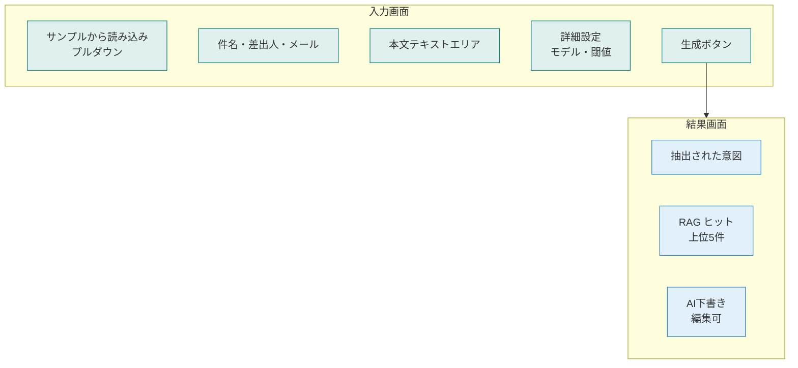
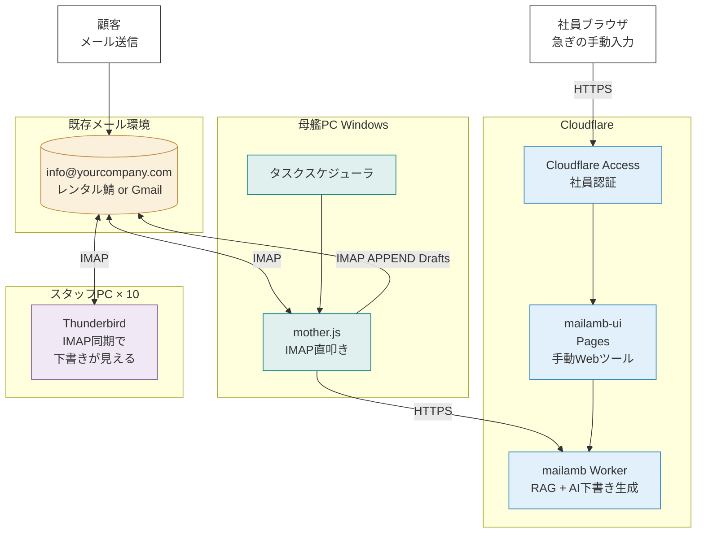
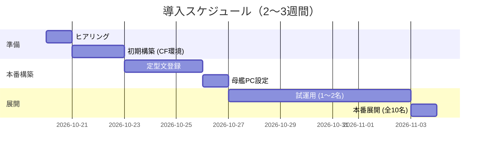

# 10. TB同期構成 + 手動Webツールの配置

> **お客様のご質問**
> 「Thunderbirdは各スタッフPCに入っていて同期して使っている。母艦PCでタスクスケジューラ毎朝バッチ、問い合わせを読んで下書き保存を想定。手動でも下書き作れるWebツールは、どこに何を置けばよいか分からない。」

への回答。

---

## 1. 既存のTB同期運用はそのまま活かせます



TB同期（IMAP）がすでに動いているので、**どのPCでDraftsフォルダに書き込んでも、全員のTBに同じ下書きが見えます**。これを前提にシステムを組みます。

---

## 2. 毎朝バッチ処理の仕組み

### 母艦PC側（Windows想定）

タスクスケジューラで毎朝 (例: 7:00) に Node.js スクリプトを起動：



**ポイント**:
- 母艦でTBアプリを**立ち上げる必要はありません**（IMAPに直接接続）
- Thunderbird が起動していなくても、スクリプトが IMAP サーバに書き込みます
- スタッフ各自のTBは普段通り使うだけで、下書きが自動で同期されてきます

### 必要なもの（母艦PC）

- Node.js 20以上
- `imapflow` ライブラリ（スクリプトに同梱）
- IMAPアカウント情報（アプリパスワード等）
- タスクスケジューラ設定（Windows標準）

### 既存の `poc/scripts/05-mother.ts` を使う

```bash
pnpm mother          # 本番実行
pnpm mother --dry    # 下書き作成するが Drafts保存しない（テスト）
pnpm mother --list   # 候補一覧だけ表示（AI呼ばない）
```

タスクスケジューラから呼ぶバッチファイル例:
```bat
@echo off
cd C:\mailamb\poc
pnpm mother >> C:\mailamb\logs\mother-%date:~0,10%.log 2>&1
```

---

## 3. 手動で下書きを作成するWebツール — どこに置くか

### 結論: **Cloudflare Pages** に置くのが最適



### なぜ Cloudflare Pages か

| 項目 | 内容 |
|---|---|
| **ホスティング** | 社内サーバ不要。Cloudflare上に無料でホスト |
| **URL** | 任意のサブドメイン（例: `https://draft.example.com`） |
| **認証** | Cloudflare Access で社員のGoogleアカウントログイン必須にできる（社員以外アクセス不可） |
| **保守** | 更新時は wrangler で deploy。ダウンタイムなし |
| **コスト** | 無料プラン内 |
| **既存Workerと連携** | 同じAPIを叩くだけ |

### Webツールの中身

既にPoCに実装済み（`poc/ui/index.html` + `poc/scripts/04-serve.ts`）。入力画面と結果画面：



### 使い方の想定シーン

- 母艦バッチが処理した後、追加で急ぎの問い合わせが届いた
- 電話で聞いた内容を元に返信文を作りたい
- Thunderbird以外（スマホ等）から下書き試作したい

### 代替案（Pages使わない場合）

| 案 | 置き場所 | 向くケース |
|---|---|---|
| **A. Cloudflare Pages** (推奨) | クラウド | 誰でもどこからでもアクセス、認証必須 |
| **B. 母艦PC上の軽量サーバ** | 社内LAN | 社外アクセス不要、ネット回線切れても使える |
| **C. 各PCに配布** | ローカルHTMLファイル | オフライン可、認証なし、更新面倒 |

**推奨**: 案A。10名規模ならコストほぼゼロで管理も楽。

---

## 4. 全体構成（お客様の環境に合わせた最終図）



### 2つの入口でカバー

| 用途 | ルート | 誰が |
|---|---|---|
| **朝のバッチ** | 母艦PC → IMAP → Drafts | 自動（タスクスケジューラ） |
| **手動の個別対応** | ブラウザ → Pages → Worker | 社員（都度） |

両方とも裏の Worker が同じ下書き生成ロジックを使うので、品質・ベースは一貫します。

---

## 5. 導入時にお客様側でご用意いただくもの

### 必須

- **母艦用PC** （Windows 推奨、常時稼働、Node.js動く）
- **メールの IMAP接続情報** （既存アカウントのパスワードやアプリパスワード）
- **Cloudflare アカウント** （新規作成、無料）
- 既存の **ドメイン** （Webツールのサブドメイン用、任意）

### あると良い

- **Google Workspace** （Cloudflare Access を Google ログインにできる）
- **既存の定型文集** （Word/Excel/テキスト形式でOK、こちらで登録）

---

## 6. 導入の進め方



| フェーズ | 期間 | 内容 |
|---|---|---|
| ヒアリング | 1日 | メール環境・定型文の棚卸し |
| 初期構築 | 1〜2日 | Cloudflare環境構築、Worker/Pages デプロイ |
| 定型文登録 | 1〜3日 | お手持ちの定型文を10〜30件登録 |
| 母艦PC設定 | 半日 | タスクスケジューラ + 母艦スクリプト設置 |
| 試運用 | 1週間 | 1〜2名のスタッフでトライアル |
| 本番展開 | 1日 | 全10名のTBに拡張配布 |

**トータル 2〜3週間** でご利用開始いただけます。
