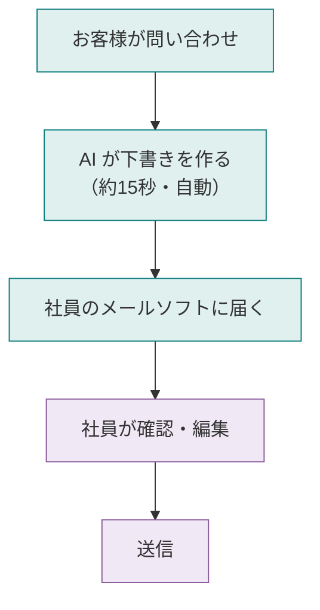

# mailamb — お問い合わせメールの返信を AI が下書き

お客様からの問い合わせメールに対して、**AI が返信の下書きを自動で作る**仕組みです。
社員の皆さんは普段どおりメールソフト（Thunderbird）を使うだけで、下書きが届きます。

---

## 流れ

| 色 | 誰が |
|---|---|
| 🟢 緑 | 自動（AI が全部やる） |
| 🟣 紫 | 社員の作業 |

---

## 社員の作業は3ステップだけ

1. **メールを開く** — 普段どおり
2. **🤖 ボタンをクリック** — AI下書きが出る
3. **確認→送信** — 編集してから送信

AI の操作スキルは不要。「AI 使わされてる感」はありません。

---

## 導入のメリット

| | |
|---|---|
| ⏱️ **スピード** | ゼロから書かず、編集するだけ |
| 📝 **品質安定** | 誰が返信しても会社としての言い回しが揃う |
| 📚 **資料活用** | 眠っていた定型文を自動で活用 |
| 💰 **コスト** | 月額ほぼ 0 円 〜 数百円 |
| 🔒 **安心** | 送信は必ず人間が判断。AI が勝手に送ることはない |

---

## 導入準備

| 項目 | 内容 |
|---|---|
| **メール** | 会社の既存メール（info@○○.com）そのまま使用 |
| **PC** | 常時稼働の母艦PC 1台（バッチ処理用） |
| **メールソフト** | Thunderbird（無料） |
| **期間** | 2〜3週間で導入完了 |

---

## こんなお悩みに

- 「同じような問い合わせに毎回ゼロから返信書いてて時間がもったいない」
- 「新人スタッフの返信文のばらつきが気になる」
- 「社内で作った定型文集が結局使われていない」
- 「AI 活用したいけど、スタッフに AI 操作教える余裕がない」

→ 全部解決します。

---

## お問い合わせ

デモ動画・詳細資料・導入見積もり、お気軽にご連絡ください。

**当社**
