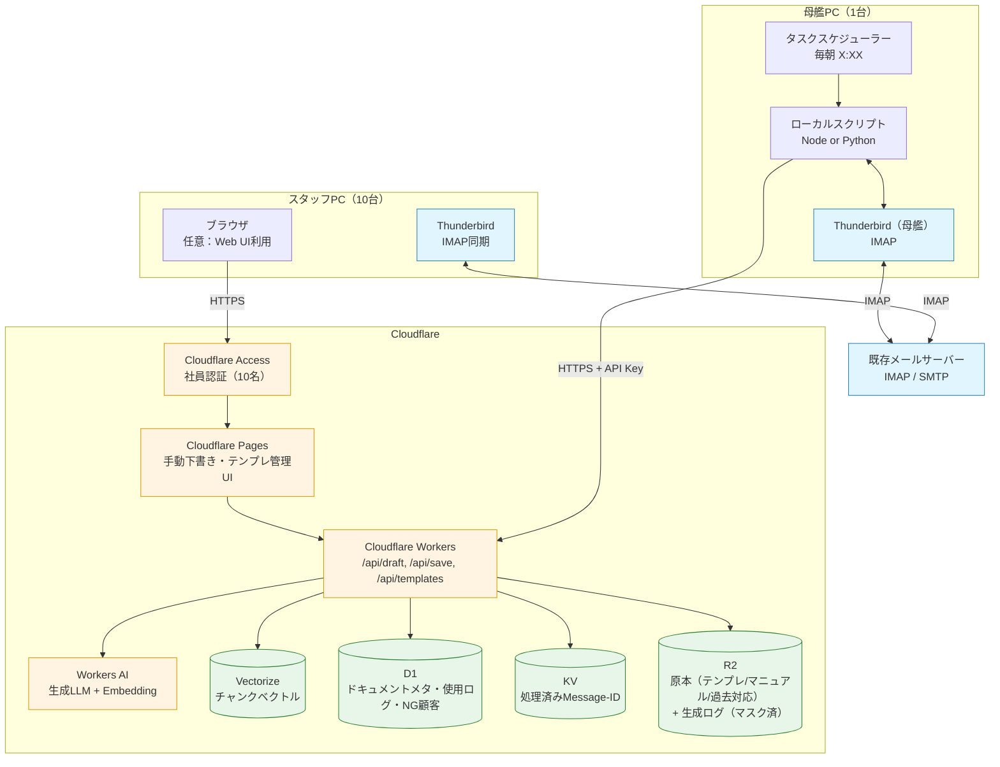
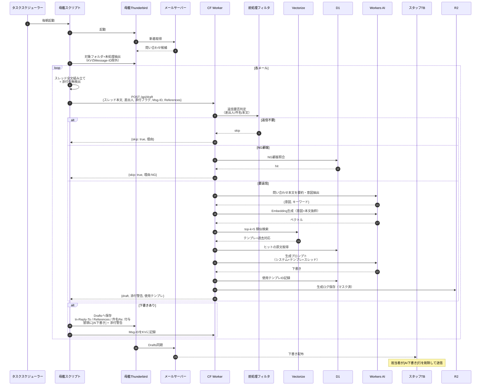
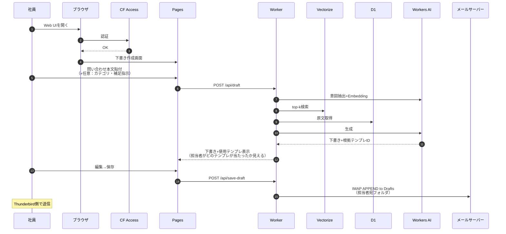

# 社内メール自動下書きシステム 構成図

## 概要

母艦PCのThunderbirdで朝バッチ下書き保存 → IMAP同期で全スタッフに配布 → 人間が最終チェックして送信。
AI生成はCloudflare Workers AIに閉じ、社員は生成UIを直接触らない運用（手動Web下書きツールは任意利用）。

## 全体構成



## 自動下書きフロー（毎朝バッチ）



## 手動下書きWebツールフロー



## コンポーネント

| 層 | 要素 | 役割 |
|---|---|---|
| 母艦PC | タスクスケジューラー | バッチ起動 |
| 母艦PC | ローカルスクリプト | TB起動・スレッド組立・ヘッダ付与・Worker呼び出し |
| 母艦PC | Thunderbird | Drafts実体保存先 |
| CF | Workers | API本体・判定・RAGオーケストレーション |
| CF | Workers AI | 意図抽出・Embedding・下書き生成 |
| CF | Vectorize | チャンクベクトル検索 |
| CF | R2 | **原本**（テンプレ/マニュアル/過去対応）+ 生成ログ |
| CF | D1 | ドキュメントメタ・チャンク索引・使用ログ・NG顧客 |
| CF | KV | 処理済みMessage-ID（重複生成防止） |
| CF | Pages | 手動下書き・テンプレ管理UI |
| CF | Access | 社員認証（Google/メール） |

## ドキュメント管理（R2 + D1 + Vectorize）

原本はR2、構造化メタはD1、ベクトルはVectorize。3層で役割分離。

### R2バケット設計
```
bucket: mailamb-docs
  templates/<doc_id>.md          -- 定型文（Markdown/txt）
  manuals/<doc_id>.md            -- 社内マニュアル・FAQ
  past_cases/<yyyy-mm>/<id>.json -- 過去対応（{問い合わせ, 返信}ペア）
  logs/<yyyy-mm-dd>/<msg_id>.json -- 生成ログ（マスク済）
```

### D1スキーマ（抜粋）
```sql
documents (
  doc_id TEXT PK,
  type TEXT,            -- template | manual | past_case
  title TEXT,
  r2_key TEXT,          -- R2のパス
  category TEXT,
  tags TEXT,            -- JSON配列
  updated_at INTEGER,
  active INTEGER        -- 失効させる時は0
)

chunks (
  chunk_id TEXT PK,
  doc_id TEXT FK,
  r2_key TEXT,
  offset INTEGER,       -- 原本内の位置
  length INTEGER,
  preview TEXT          -- 冒頭100文字（UI表示用）
)

template_usage (...)   -- 既出
ng_senders (...)       -- 既出
```

### Vectorize index
```
index: mailamb-docs
  dim: 1024 (bge-m3)
  metric: cosine
  metadata:
    - doc_id
    - chunk_id
    - type: template | manual | past_case
    - category
    - updated_at
```
- `metadata.chunk_id` → D1の `chunks` → `r2_key + offset` でR2から該当チャンク取得

## RAG設計

### 登録パイプライン（管理UIからアップロード時）
1. 原本をR2にPUT（`templates/<doc_id>.md` 等）
2. D1 `documents` にメタ登録
3. Workerがchunker実行: 500〜800トークン、オーバーラップ100、見出し境界優先
4. 各チャンクを `@cf/baai/bge-m3` でEmbedding
5. Vectorizeに upsert（metadata にdoc_id/chunk_id）
6. D1 `chunks` にoffset/preview記録
7. 更新時: 旧ベクトル全削除→再生成（doc_id単位でpurge）

### 検索戦略
1. 問い合わせ本文を**要約+意図抽出**（AI 1回）→ ノイズ除去
2. 要約文でEmbedding生成
3. Vectorizeに top-k=8 で問い合わせ
4. スコア閾値（例: 0.70）未満は除外
5. 同一 doc_id のチャンクは最高スコアのみ残す（重複削減）
6. 上位3〜5件: `chunks.r2_key` からR2取得 → プロンプト同梱

### フォールバック
- 全ヒットが閾値未満 → 「汎用あいさつ+担当振り分け依頼」の固定テンプレ（R2 `templates/_fallback.md`）
- 下書き冒頭に `[テンプレ該当なし・要全文作成]` マーカー

## 前処理フィルタ（返信要否判定）

Workerの先頭で軽量判定、AIコストを使う前に落とす。

| 判定 | ルール | アクション |
|---|---|---|
| 対象外フォルダ | 母艦スクリプト側で Inbox 配下の特定フォルダのみ対象 | 読み込まない |
| スパム判定済 | X-Spam ヘッダ or TBフィルタで振り分け済 | skip |
| 社内ドメイン | 差出人が自社ドメイン | skip |
| メルマガ/広告 | List-Unsubscribe ヘッダ有 or 送信元が既知配信元リスト（D1） | skip |
| 自動返信 | Auto-Submitted ヘッダ有 | skip |
| NG顧客 | D1の ng_senders テーブルに差出人一致 | skip（通知のみ） |
| 要返信 | 上記いずれにも該当せず | 生成パイプラインへ |

## スレッド文脈の扱い

- 母艦スクリプトが対象メールの `References` ヘッダから同一スレッドの過去メールをIMAPで取得
- 新しい順で最大N通（例: 直近5通）を本文連結
- 各メールに `--- 2026-10-10 差出人: xxx ---` の区切り
- プロンプト構造:
  ```
  [システム] テンプレ3つ + 社の返信ルール
  [スレッド] 過去やり取り（連結）
  [最新] 今回の問い合わせ
  [指示] 最新に対する返信を生成。過去の約束事項を踏襲
  ```

## 添付・ヘッダ処理

### 添付ファイル
- 母艦スクリプトで添付メタ（ファイル名・サイズ）抽出
- 下書き冒頭に挿入:
  ```
  [AI下書き]
  ⚠ 添付あり: 見積書.pdf (240KB), 契約書.docx (180KB)
  ⚠ 添付内容はAIに読ませていません。手動で確認してください
  ---
  （本文）
  ```

### 返信ヘッダ（必須）
- `In-Reply-To`: 元メールのMessage-ID
- `References`: 元の References + 元Message-ID
- `Subject`: `Re: ` 付与（既にあれば重複させない）
- → Thunderbird側で元メールとスレッド表示される

## データ保護（Cloudflare送信時）

- **マスキング**: 送信前に電話番号・口座番号・マイナンバー等を正規表現で `[REDACTED]` 置換（D1に置換辞書）。本文全体ではなく「保護対象パターン」のみ
- **NG顧客テーブル**: D1の `ng_senders` に該当する差出人は、そもそもWorker/AIに送らず母艦スクリプト側で止める（Workerに送らないのが安全）
- **ログ**: R2保存は本文マスク済み版のみ。生ログは保存しない
- **Workers AI**: 入力はトレーニング非利用（Cloudflareのデータ利用規約を要確認し、本番前にスクショ保存）
- **保持期間**: R2ログは90日で自動削除（ライフサイクルルール）

## テンプレ運用ログ

D1の `template_usage`:
```
template_id, email_msg_id, generated_at,
staff_edited: bool,        -- 下書きが送信前に編集されたか（送信時Hookで判定）
staff_discarded: bool,     -- 下書きが削除されたか
edit_distance: int         -- 編集量（任意）
```

- 編集率が高いテンプレ → 鮮度低下シグナル
- 使用0件のテンプレ → 不要候補
- 管理UIでランキング表示

編集・破棄の検出は母艦スクリプトが夜間にDraftsとSentを突き合わせて判定（別バッチ）。

## 決定事項

| 項目 | 決定 |
|---|---|
| 母艦OS | **Windows**（タスクスケジューラ標準） |
| 自動バッチ実行環境 | Node.js スクリプト、`imapflow`等でIMAP直接接続（TB起動不要） |
| TB連携方式 | **IMAP直叩き** — 母艦PCでTBは立ち上げない。母艦PCはIMAP APPEND専用マシン |
| 手動Web下書き保存先 | **本人（ログインユーザ）のDrafts** |
| 生成LLM | `@cf/meta/llama-3.3-70b-instruct-fp8-fast`（初期値、評価後変更可） |
| Embedding | `@cf/baai/bge-m3` |

## 残る未確定事項（追加決定が必要）

### A. メールサーバの種類
「本人のDraftsに保存」を実現する認証方式がサーバ種別で変わる。
- Google Workspace / Microsoft 365 → OAuth2可、各ユーザのトークンを安全に扱える
- 自前IMAP / レンタルサーバ → パスワード認証のみの場合が多い

### B. 本人Drafts保存の実装方式（Aの回答に依存）
| 方式 | 条件 | 評価 |
|---|---|---|
| OAuth2（ユーザごとのトークン） | Google/M365 | ◎ 推奨。CFにパス不要 |
| ユーザ別IMAPパスをSecretsに保持 | 自前IMAP | △ 運用重・退職時更新 |
| ログイン時に都度IMAPパス入力（セッション内保持） | 自前IMAP | ○ 妥協案 |
| 共有Drafts "AI下書き/<ユーザ名>/" にWorker書込み、各PCのTBが監視 | どれでも | ○ 当初決定（共有Drafts）に戻す案 |

### C. 自動バッチで監視する「問い合わせ」の判別ルール
母艦PCは1アカウントで全問い合わせを受け取るのか、各ユーザアカウントを巡回するのか。
- 案1: 専用の受付用IMAPアカウント（例: `info@`）だけ監視
- 案2: 各ユーザのInboxを巡回（複数アカウントへの接続情報が必要）
- 案3: Inbox内の特定フォルダ（TBフィルタで振り分け済）のみ対象
